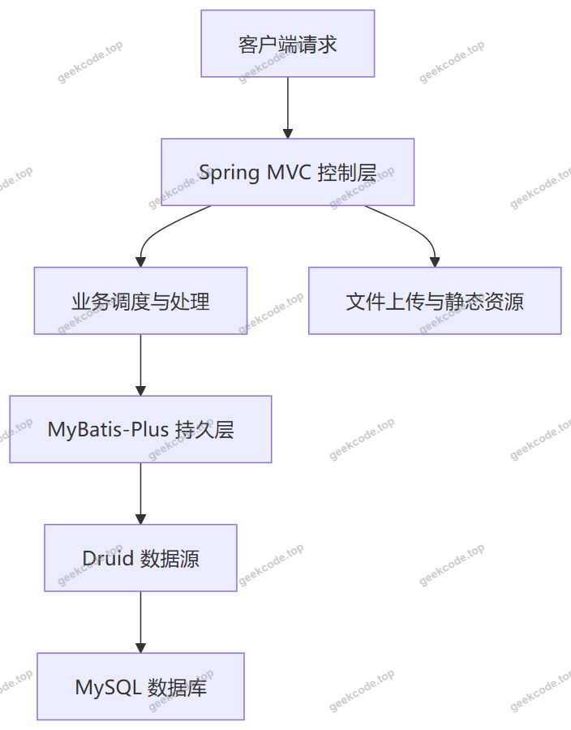
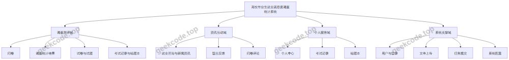
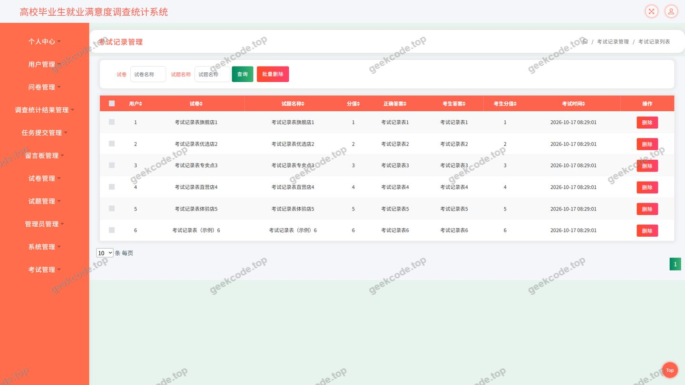
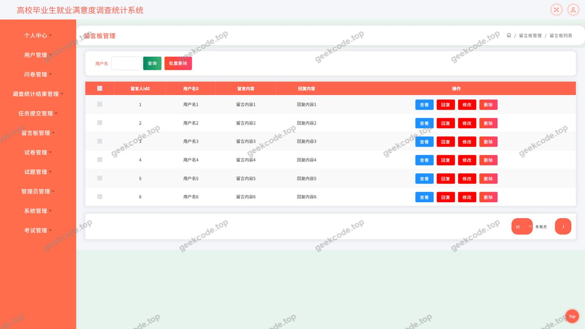
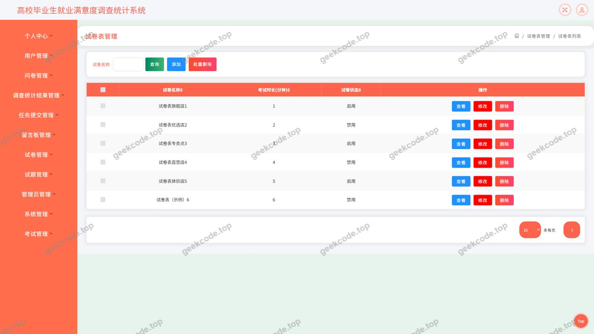
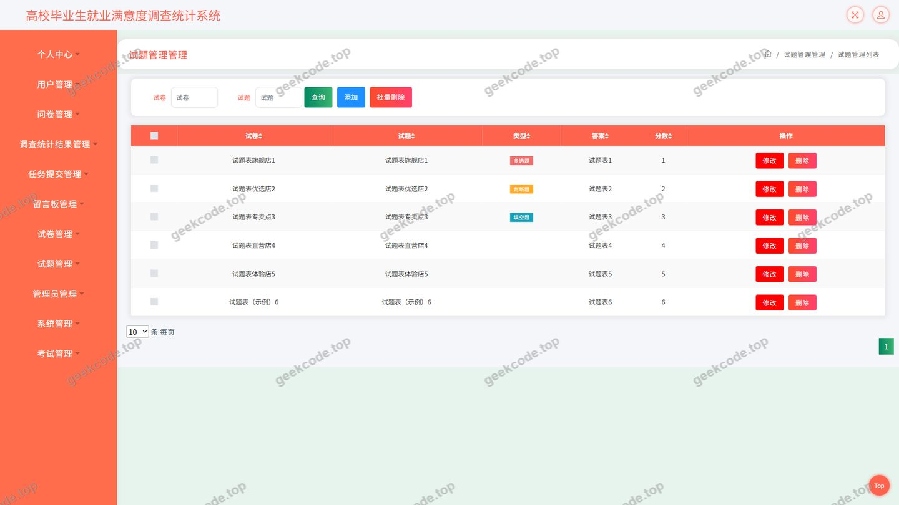
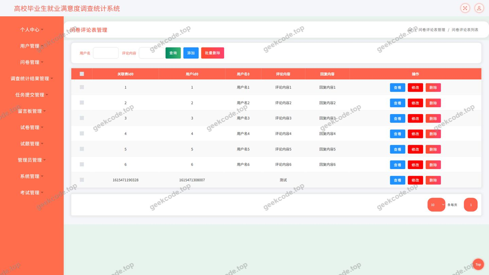
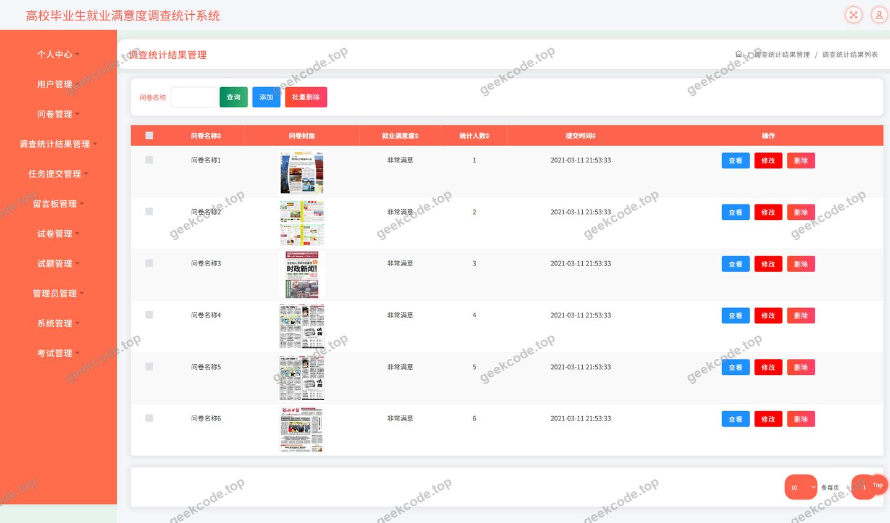
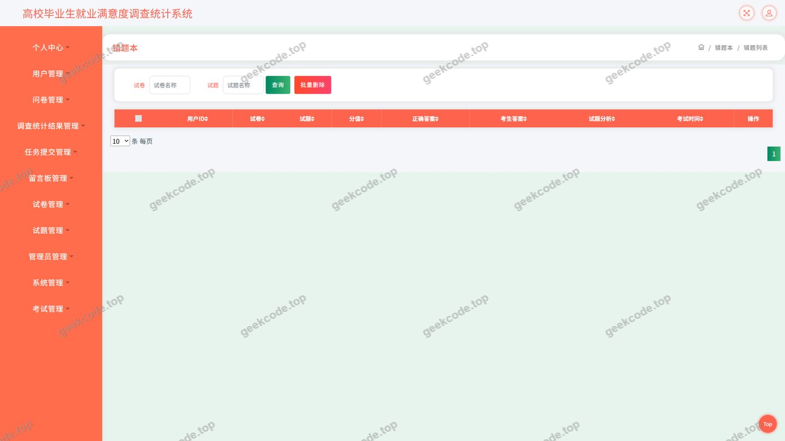
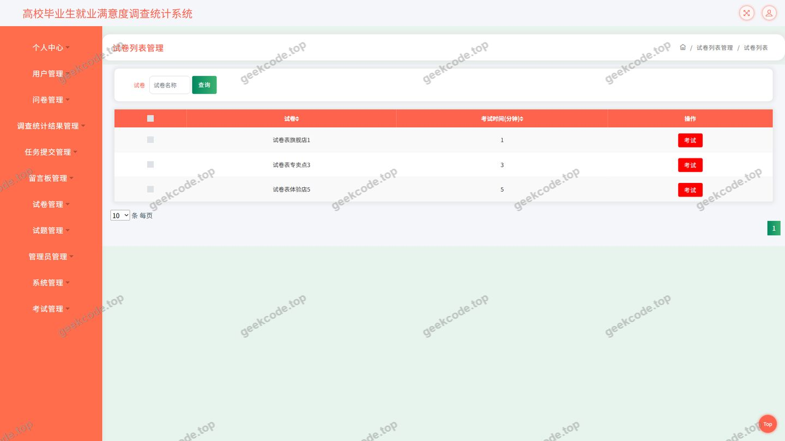

# java毕业设计ssm高校毕业生就业满意度调查统计系统计算机毕业设计

> 🎓 **计算机毕业设计 · java毕业设计ssm高校毕业生就业满意度调查统计系统计算机毕业设计**
>
> 本仓库只放**项目介绍 + 运行截图**（截图是站点带水印的原图，存在仓库 `images/` 里）。
>
> 👉 **完整可运行源码 / 数据库脚本 / 部署文档：[点我获取](https://geekcode.top/archives/java%E6%AF%95%E4%B8%9A%E8%AE%BE%E8%AE%A1ssm%E9%AB%98%E6%A0%A1%E6%AF%95%E4%B8%9A%E7%94%9F%E5%B0%B1%E4%B8%9A%E6%BB%A1%E6%84%8F%E5%BA%A6%E8%B0%83%E6%9F%A5%E7%BB%9F%E8%AE%A1%E7%B3%BB%E7%BB%9F%E8%AE%A1%E7%AE%97%E6%9C%BA%E6%AF%95%E4%B8%9A%E8%AE%BE%E8%AE%A1?utm_source=github)**
>
> 💬 咨询微信：**ir9372**　|　🌐 更多项目：[极客代码 geekcode.top](https://geekcode.top/?utm_source=github)
>
> 📌 项目详情页：<https://geekcode.top/archives/java%E6%AF%95%E4%B8%9A%E8%AE%BE%E8%AE%A1ssm%E9%AB%98%E6%A0%A1%E6%AF%95%E4%B8%9A%E7%94%9F%E5%B0%B1%E4%B8%9A%E6%BB%A1%E6%84%8F%E5%BA%A6%E8%B0%83%E6%9F%A5%E7%BB%9F%E8%AE%A1%E7%B3%BB%E7%BB%9F%E8%AE%A1%E7%AE%97%E6%9C%BA%E6%AF%95%E4%B8%9A%E8%AE%BE%E8%AE%A1?utm_source=github>

<table><td width="230" align="center"> <b>扫码加微信 ir9372</b></td><td valign="middle">📦 源码 = 项目介绍 + 全部运行截图 + 数据库 + 部署文档 👉 点上方任意截图，直接跳到 <b>极客代码 geekcode.top</b> 详情页</td></table>

---

<h1>java毕业设计_ssm高校毕业生就业满意度调查统计系统_计算机毕业设计</h1>
<h2>项目概述</h2>

本项目为面向高校毕业生就业满意度调查统计场景的计算机毕业设计项目，采用纯 API 架构（pure-api），后端基于 Spring 生态与 MyBatis-Plus 持久层框架构建，数据源使用 Druid 连接池。系统以接口形式对外提供服务，围绕&quot;就业满意度调查&quot;这一核心业务，构建了问卷发布与填写、问卷评论互动、调查统计结果输出、在线试卷与试题管理、在线考试与考试记录留存、错题记录、就业咨询与新闻资讯发布、留言反馈、用户管理、文件上传与任务提交、系统配置等能力。

系统设置问卷、就业咨询、试卷列表、新闻资讯、留言反馈等前台功能入口，以及个人中心、考试记录、错题本等个人服务入口，配合登录、用户管理、留言板管理、试卷管理、试题管理、考试记录与错题记录管理等页面，形成&quot;调查采集—数据统计—考试测评—互动反馈&quot;的闭环。适用人群为高校毕业生就业指导相关业务的使用者与管理人员，亦可作为同类调查统计类信息系统的参考实现。

<h2>技术架构</h2>
<h3>整体架构</h3>

项目为纯后端接口服务，采用经典的分层结构：由 Spring MVC 承担 Web 表现层职责，接收客户端 HTTP 请求并返回 JSON 数据；控制器（Controller）作为请求入口完成参数接收与校验、业务调度与结果封装；持久层由 MyBatis-Plus 负责，屏蔽 JDBC 细节并提供通用 CRUD、条件构造与分页能力；数据源由 Druid 统一管理。

需要说明的是，本项目的&quot;前台&quot;与&quot;后台&quot;在仓库中表现为接口能力与页面形态，前后端未在同一工程内以路由配置的形式分离，现有上下文中未提供前台路由与后台路由配置。

<h3>架构示意</h3>

<h3>核心控制器与职责划分</h3>

现有代码上下文中包含以下控制器，构成系统的接口主体：

<table>
<thead>
<tr>
<th>控制器</th>
<th>承担职责</th>
</tr>
</thead>
<tbody><tr>
<td>CommonController</td>
<td>通用接口，承担跨模块的公共请求处理</td>
</tr>
<tr>
<td>ConfigController</td>
<td>系统配置相关接口</td>
</tr>
<tr>
<td>UserController</td>
<td>用户登录、用户信息与用户管理相关接口</td>
</tr>
<tr>
<td>DiscusswenjuanController</td>
<td>问卷评论（问卷互动）相关接口</td>
</tr>
<tr>
<td>DiaochatongjijieguoController</td>
<td>调查统计结果相关接口</td>
</tr>
<tr>
<td>ExampaperController</td>
<td>试卷管理相关接口</td>
</tr>
<tr>
<td>ExamquestionController</td>
<td>试题管理相关接口</td>
</tr>
<tr>
<td>ExamrecordController</td>
<td>考试记录相关接口</td>
</tr>
<tr>
<td>NewsController</td>
<td>新闻资讯相关接口</td>
</tr>
<tr>
<td>MessagesController</td>
<td>留言反馈相关接口</td>
</tr>
<tr>
<td>RenwutijiaoController</td>
<td>任务提交相关接口</td>
</tr>
<tr>
<td>FileController</td>
<td>文件上传与文件访问相关接口</td>
</tr>
</tbody></table>
<h3>数据库设计要点</h3>

依据控制器所覆盖的业务，数据库层面至少需要支撑以下数据实体：用户、问卷及其评论、调查统计数据、试卷、试题、考试记录与错题记录、新闻资讯、留言反馈、任务提交记录、系统配置、文件资源。

在持久层实现上，MyBatis-Plus 通过实体类与数据表建立映射，主键策略、字段映射、逻辑删除与自动填充等均可通过注解与全局配置统一管理，从而减少重复的 SQL 编写。具体表名、字段构成、索引与外键约束，现有代码上下文中未提供，无法确定。

<h3>技术选型理由</h3>
<ul>
<li><strong>Spring Core / Spring Context / Spring Beans / Spring AOP</strong>：提供 IoC 容器与面向切面能力，实现组件解耦与横切逻辑（如事务、日志）的统一处理。</li>
<li><strong>Spring MVC（spring-web、spring-webmvc）</strong>：以注解方式定义请求映射，便于构建 REST 风格接口并返回结构化数据，契合 pure-api 项目形态。</li>
<li><strong>Spring JDBC / Spring TX</strong>：为数据访问与声明式事务提供基础支撑。</li>
<li><strong>MyBatis-Plus</strong>：在 MyBatis 基础上提供通用 Mapper 与通用 Service，支持条件构造器、分页查询等常用能力，显著提升数据访问层开发效率。</li>
<li><strong>Druid</strong>：作为数据库连接池，提供连接复用、连接有效性检测与运行期监控能力。</li>
<li><strong>JUnit</strong>：用于单元测试，保障核心业务逻辑的可验证性。</li>
</ul>
<h2>功能模块</h2>
<h3>用户端功能模块</h3>
<ul>
<li><strong>登录</strong>：提供用户身份认证入口，是访问个人中心、考试记录、错题本等个人数据的必要前提。</li>
<li><strong>问卷</strong>：面向就业满意度调查的核心模块，支持问卷内容的展示与提交，用户可参与问卷作答；结合问卷评论模块，支持用户围绕问卷展开互动讨论。</li>
<li><strong>就业咨询与新闻资讯</strong>：由新闻资讯相关接口提供信息内容的发布与查询能力，为用户提供就业政策、行业动态等资讯浏览服务。就业咨询菜单与新闻资讯菜单在控制器层面的具体对应关系，现有代码上下文未明确区分，无法确定。</li>
<li><strong>试卷列表</strong>：展示可供作答的试卷清单，用户可从中选择试卷进入考试流程。</li>
<li><strong>在线考试与考试记录</strong>：依据试卷与试题数据组织考试内容，考试完成后生成考试记录，用户可在个人中心查看历史考试情况。</li>
<li><strong>错题本</strong>：面向考试失败的题目形成错题记录，供用户回顾与复习，对应 examfailrecord 页面。</li>
<li><strong>留言反馈</strong>：由留言反馈接口支撑，用户可提交留言并查看留言板内容。</li>
<li><strong>个人中心</strong>：集中承载个人信息查看与维护、考试记录入口、错题本入口等个人服务。</li>
<li><strong>文件上传与任务提交</strong>：由文件接口与任务提交接口提供相关能力，服务于需要上传材料或提交任务的业务场景。</li>
<li><strong>调查统计结果</strong>：对问卷采集的数据进行汇总与统计输出，为就业满意度分析提供数据依据。</li>
</ul>
<h3>管理端功能模块</h3>
<ul>
<li><strong>用户管理</strong>：对系统用户信息进行维护，对应&quot;页面-用户&quot;。</li>
<li><strong>问卷评论管理</strong>：对问卷互动内容进行查看与管理，对应&quot;页面-问卷评论&quot;。</li>
<li><strong>试卷管理</strong>：对试卷信息进行新增、修改、查询与维护，对应&quot;页面-试卷&quot;与&quot;页面-exampaperlist&quot;。</li>
<li><strong>试题管理</strong>：对试卷下的题目进行维护，对应&quot;页面-试题&quot;。</li>
<li><strong>考试记录管理</strong>：查看考试记录数据，对应&quot;页面-考试记录&quot;。</li>
<li><strong>错题记录管理</strong>：查看考试失败记录，对应&quot;页面-examfailrecord&quot;。</li>
<li><strong>留言板管理</strong>：查看与处理用户留言反馈，对应&quot;页面-留言板&quot;。</li>
<li><strong>新闻资讯管理</strong>：由新闻资讯接口承载信息内容的维护。</li>
<li><strong>系统配置管理</strong>：由配置接口承载系统级参数的维护。</li>
</ul>
<h3>模块结构示意</h3>

<h2>用户角色与权限</h2>

系统中的角色划分为系统管理员与普通用户两类。现有代码上下文与截图功能列表中未出现教师、学生等第三方角色定义，因此不设该类角色。

<h3>系统管理员</h3>

管理员面向系统数据与内容进行集中管理，可访问的功能模块包括：

<ul>
<li><strong>登录</strong>：通过登录页面进入系统。</li>
<li><strong>用户管理</strong>：对用户信息进行查询与维护（页面-用户）。</li>
<li><strong>问卷评论管理</strong>：查看与管理问卷评论内容（页面-问卷评论）。</li>
<li><strong>试卷管理</strong>：维护试卷数据及试卷列表（页面-试卷、页面-exampaperlist）。</li>
<li><strong>试题管理</strong>：维护试卷对应的试题数据（页面-试题）。</li>
<li><strong>考试记录管理</strong>：查看考试记录（页面-考试记录）。</li>
<li><strong>错题记录管理</strong>：查看考试失败记录（页面-examfailrecord）。</li>
<li><strong>留言板管理</strong>：查看与处理留言反馈（页面-留言板）。</li>
<li><strong>新闻资讯管理</strong>：维护新闻资讯与就业资讯内容。</li>
<li><strong>调查统计结果查看</strong>：查看问卷调查的统计数据。</li>
<li><strong>系统配置管理</strong>：维护系统运行相关配置参数。</li>
</ul>
<h3>普通用户</h3>

普通用户面向个人调查参与、考试测评与信息服务，可访问的功能模块包括：

<ul>
<li><strong>登录</strong>：通过登录页面完成身份认证。</li>
<li><strong>问卷</strong>：浏览并参与就业满意度问卷作答。</li>
<li><strong>问卷评论</strong>：围绕问卷发表评论并查看他人评论。</li>
<li><strong>就业咨询</strong>：查看就业相关的咨询信息。</li>
<li><strong>新闻资讯</strong>：浏览系统发布的新闻资讯内容。</li>
<li><strong>试卷列表</strong>：查看可作答的试卷清单。</li>
<li><strong>在线考试</strong>：选择试卷进行作答并提交。</li>
<li><strong>考试记录</strong>：在个人中心查看本人的考试记录。</li>
<li><strong>错题本</strong>：查看本人考试失败形成的错题记录。</li>
<li><strong>留言反馈</strong>：提交留言反馈并查看留言板内容。</li>
<li><strong>个人中心</strong>：查看与维护个人基本信息。</li>
<li><strong>文件上传与任务提交</strong>：上传相关文件并提交任务。</li>
</ul>
<h2>项目特色与创新点</h2>
<ol>
<li><strong>以调查统计为核心主线</strong>：系统将问卷采集、问卷评论互动与调查统计结果输出串联为完整链路，形成从数据采集到统计呈现的业务闭环，区别于单一的问卷填写工具。</li>
<li><strong>调查与测评能力融合</strong>：在同一系统内同时具备就业满意度调查与在线考试测评能力，配套试卷、试题、考试记录与错题本，可用于就业指导场景下的知识测评与结果追踪。</li>
<li><strong>接口化的纯后端架构</strong>：项目采用 pure-api 形态，所有能力通过 Spring MVC 暴露为接口，前端表现与后端服务解耦，便于面向多终端复用。</li>
<li><strong>持久层开发效率优化</strong>：引入 MyBatis-Plus 承担通用数据访问职责，减少样板代码，同时结合 Druid 连接池保障数据库访问的稳定性与可观测性。</li>
<li><strong>互动反馈机制完善</strong>：通过留言反馈、问卷评论等模块建立用户与管理方之间的双向沟通渠道，使调查过程具备反馈与修正能力。</li>
<li><strong>个人数据沉淀</strong>：个人中心、考试记录与错题本共同构成个人数据沉淀与回顾体系，提升用户参与调查与测评后的持续价值。</li>
</ol>
<h2>部署环境</h2>
<h3>运行环境</h3>
<table>
<thead>
<tr>
<th>类别</th>
<th>要求</th>
</tr>
</thead>
<tbody><tr>
<td>JDK</td>
<td>需支持 Spring 与 MyBatis-Plus 运行，具体版本以项目构建配置为准</td>
</tr>
<tr>
<td>构建工具</td>
<td>用于依赖管理与打包部署</td>
</tr>
<tr>
<td>数据库</td>
<td>MySQL，需预先创建业务数据库并导入初始化脚本</td>
</tr>
<tr>
<td>数据库连接池</td>
<td>Druid，通过配置文件设置连接参数</td>
</tr>
<tr>
<td>Web 容器</td>
<td>支持 Spring MVC 运行的 Servlet 容器</td>
</tr>
<tr>
<td>单元测试</td>
<td>JUnit</td>
</tr>
</tbody></table>
<h3>依赖组件</h3>

项目依赖的核心组件包括 junit、spring-core、spring-context、spring-context-support、spring-tx、spring-aop、spring-beans、spring-jdbc、spring-web、spring-webmvc，以及 MyBatis-Plus 与 Druid。

<h3>部署说明</h3>
<ol>
<li>安装并配置 JDK 与数据库服务，创建业务库。</li>
<li>在项目配置文件中配置数据库连接地址、账号、密码及 Druid 连接池参数。</li>
<li>引入项目依赖并构建打包，启动 Web 服务。</li>
<li>通过接口地址访问登录、问卷、试卷、考试记录、留言反馈等功能。</li>
</ol>

本项目为纯 API 项目，未包含独立的前台或后台前端工程，因此不涉及 Node.js 及微信开发者工具的运行依赖。

<h2>五、技术特性</h2>
<ul>
<li>使用 MyBatis-Plus 简化数据访问层开发</li>
</ul>
<h2>六、功能模块截图</h2>
<h3>后台管理端</h3>
<h4>页面-登录</h4>

<h4>页面-考试记录</h4>

<h4>页面-留言板</h4>

<h4>页面-试卷</h4>

<h4>页面-试题</h4>

<h4>页面-问卷评论</h4>

<h4>页面-用户</h4>

<h4>页面-examfailrecord</h4>

<h4>页面-exampaperlist</h4>

---

## 获取完整源码

| 项目 | 说明 |
| --- | --- |
| 项目名 | java毕业设计ssm高校毕业生就业满意度调查统计系统计算机毕业设计 |
| 运行截图 | 本文 11 张（站点带水印原图，仓库 `images/` 目录） |
| 完整源码 | [https://geekcode.top/archives/java%E6%AF%95%E4%B8%9A%E8%AE%BE%E8%AE%A1ssm%E9%AB%98%E6%A0%A1%E6%AF%95%E4%B8%9A%E7%94%9F%E5%B0%B1%E4%B8%9A%E6%BB%A1%E6%84%8F%E5%BA%A6%E8%B0%83%E6%9F%A5%E7%BB%9F%E8%AE%A1%E7%B3%BB%E7%BB%9F%E8%AE%A1%E7%AE%97%E6%9C%BA%E6%AF%95%E4%B8%9A%E8%AE%BE%E8%AE%A1?utm_source=github](https://geekcode.top/archives/java%E6%AF%95%E4%B8%9A%E8%AE%BE%E8%AE%A1ssm%E9%AB%98%E6%A0%A1%E6%AF%95%E4%B8%9A%E7%94%9F%E5%B0%B1%E4%B8%9A%E6%BB%A1%E6%84%8F%E5%BA%A6%E8%B0%83%E6%9F%A5%E7%BB%9F%E8%AE%A1%E7%B3%BB%E7%BB%9F%E8%AE%A1%E7%AE%97%E6%9C%BA%E6%AF%95%E4%B8%9A%E8%AE%BE%E8%AE%A1?utm_source=github) |
| 咨询微信 | **ir9372**（备注：jingpin-yuanma） |
| 更多项目 | [极客代码 geekcode.top](https://geekcode.top/?utm_source=github) |

> 需要源码、部署、改配置、跑不起来等问题，加微信 ir9372 沟通，说明项目名即可。
